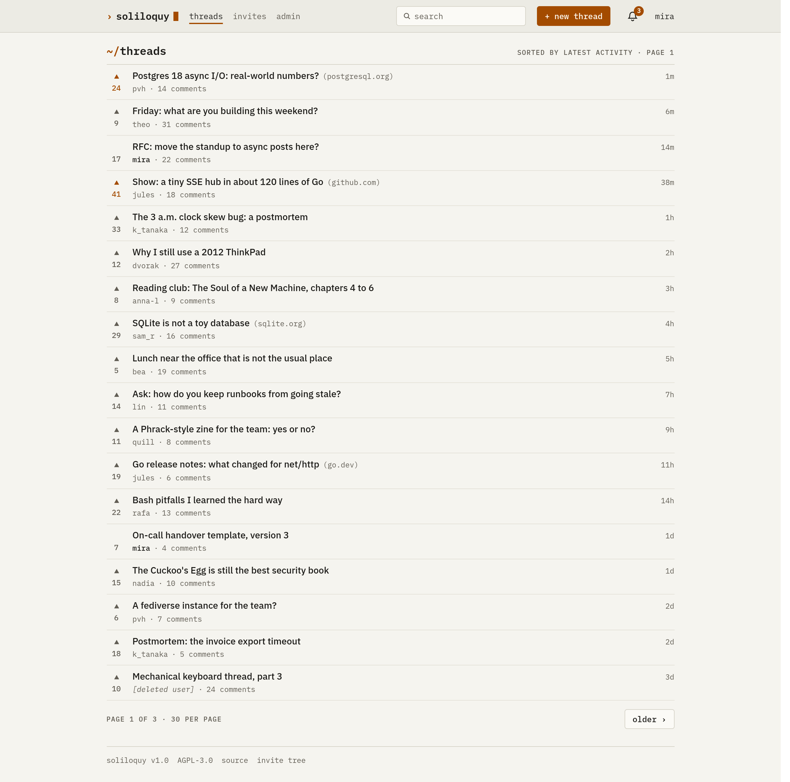

# Soliloquy

A small, lightweight, private forum for work discussions and friendly chats.

Soliloquy is made for long-form discussion: long posts, long replies and deep
threads should be comfortable to write and to read.

<a href="docs/images/front-page.png"></a>

- Invite-only. Any member can invite others, and everyone can see who invited whom.
- Private by default. An admin can make the forum public, so visitors can read
  threads and search without an account. Visitors cannot post, vote or comment.
- Admins can rename the forum.
- Threads with nested comments, like Hacker News and Reddit.
- Every comment has its own page that shows the comment and its replies at full
  width, so a deep thread stays readable. Click the time of a comment to open
  it.
- New comments, edits, deletes, vote counts and notifications appear live, with
  no page reload.
- RSS feeds for new threads, all new comments and your own notifications, with
  a secret link per member so feeds work on a private forum.
- A small read-only JSON API for threads and comments.
- Notifications outside the forum: desktop alerts in the browser, and phone
  pushes through [ntfy](https://ntfy.sh/).
- Markdown, upvotes, emoji reactions, @mentions, full-text search and dark mode.
- Drafts. Text you have not posted yet stays in your browser, so a closed tab
  or a failed post does not lose it.
- One Go binary and one SQLite file, taking up 5 MB of RAM, to make Sam Altman livid.
  Put a reverse proxy in front of it and you are done.

See [docs/PRD.md](docs/PRD.md) for the full requirements.

## Running

Each [release](https://github.com/skorokithakis/soliloquy/releases) has
prebuilt binaries for Linux and macOS, on amd64 and arm64. Download the archive
for your platform, unpack it and run `./soliloquy`.

Each release also has a Docker image for Linux on amd64 and arm64:

```sh
docker run -d -p 8080:8080 -v soliloquy-data:/data \
  -e SOLILOQUY_BASE_URL=https://forum.example.com \
  ghcr.io/skorokithakis/soliloquy:latest
```

Use a version tag, such as `ghcr.io/skorokithakis/soliloquy:0.1.0`, instead of
`latest` to pin a release.

To build the binary yourself (Go 1.24 or later, no CGO needed):

```sh
CGO_ENABLED=0 go build -o soliloquy .
./soliloquy -base-url https://forum.example.com
```

Or build the Docker image yourself:

```sh
docker build -t soliloquy .
docker run -d -p 8080:8080 -v soliloquy-data:/data \
  -e SOLILOQUY_BASE_URL=https://forum.example.com soliloquy
```

### Docker Compose and Harbormaster

The repository has a `compose.yaml` file. It builds the image, keeps the
database in a named volume called `data`, and publishes the app on
`127.0.0.1:53684`. Only a reverse proxy on the same host can reach that
address. To run it by hand:

```sh
SOLILOQUY_BASE_URL=https://forum.example.com docker compose up -d --build
```

The file works with [Harbormaster](https://harbormaster.readthedocs.io/). Add
the app to your `harbormaster.yml`:

```yaml
apps:
  soliloquy:
    url: https://github.com/skorokithakis/soliloquy.git
    branch: master
    manage_volumes: true
    environment:
      SOLILOQUY_BASE_URL: https://forum.example.com
```

With `manage_volumes: true`, the database is in
`data/soliloquy/data/soliloquy.db` under the Harbormaster working directory.
Back up that directory (see [Backups](#backups)). To get the first admin invite
URL, run `docker compose logs` in `repos/soliloquy/`.

### Settings

Each setting is a flag or an environment variable. A flag wins over the
environment variable.

| Flag | Environment variable | Default | Meaning |
|---|---|---|---|
| `-listen` | `SOLILOQUY_LISTEN_ADDR` | `:8080` | Address to listen on. |
| `-db` | `SOLILOQUY_DB_PATH` | `soliloquy.db` | Path of the SQLite file. |
| `-base-url` | `SOLILOQUY_BASE_URL` | `http://localhost:8080` | The public URL of the forum. |
| `-allow-any-origin` | `SOLILOQUY_ALLOW_ANY_ORIGIN` | `false` | Turn off the `Origin` check. This turns off CSRF protection. Use it only on QA and debugging servers. |
| — | `SOLILOQUY_METRICS_TOKEN` | empty | Bearer token for `/metrics`. Read from the environment only, so it does not show up in the process list. Empty turns the endpoint off. |

The base URL must be the exact URL that users type into their browser. The
app uses it to build invite and reset links. It also rejects any form post
whose `Origin` header does not match it, so a wrong base URL makes every form
fail with "403 Forbidden".

### The first admin

When the app starts with an empty database, it writes a one-time admin invite
URL to the log:

```
2026/01/01 12:00:00 INFO first admin invite url=https://forum.example.com/invite/...
```

Open that URL to create the first account. Each restart before then makes a
new URL and the old one stops working. After the first account exists, members
invite other people from the "My invites" page.

### Site settings

Admins open `/admin/settings` from the admin page. They can rename the forum
and make it public.

The forum is private by default. Visitors are sent to the login page.

When the forum is public, visitors can read the front page, thread pages and
search. They see scores but no vote buttons, and a "log in" link in place of
the new-thread, notifications and account links. Every other page and every
write sends them to the login page. They do not get live updates.

### Feeds

The forum has RSS 2.0 feeds for the 50 newest threads, the 50 newest
comments and the 50 newest notifications of one member:

- `/feeds/threads`
- `/feeds/comments`
- `/feeds/notifications`

On a public forum anyone can read the threads and comments feeds. The
notifications feed is personal, so it always needs the member's token. On a
private forum each feed needs a secret token: members find their personal
links in the "feeds" section of their account page, and can reset them there
if a link leaks. The same token keeps working when the forum is switched
between public and private. It grants read-only access and cannot be used to
log in.

### JSON API

The forum has a small read-only JSON API:

- `/api/threads?page=N` lists threads in front page order, 30 per page. The
  response has `threads`, `page` and `has_next`.
- `/api/threads/{id}` returns one thread, with its body as Markdown (`body`)
  and as sanitized HTML (`body_html`), and its comments as a nested tree. Each
  comment has its replies in `replies`. A deleted comment that still has
  replies appears with `deleted: true` and no author or body.

Access works like the feeds. A logged-in browser session works, and so does the
feed token from the account page as `?token=...`. On a public forum no token is
needed. A refused request gets a 404.

Members can find the full API reference, with their own tokenized links, at
`/account/api`. The account page links to it.

### Notifications

Members get an in-app notification for a reply to their comment, a top-level
comment on their thread, and an @mention. They can also follow a thread with
the "follow" button in the line under its title. A followed thread sends one
notification for each new comment, at any depth, through the same channels as
the other notifications. Following is opt-in: posting a thread or a comment
never follows it. In the "notifications" section of the account page they can
also:

- Turn on desktop alerts. The browser shows an alert for each new notification
  while a forum tab is open in the background. This setting is per browser.
- Set an ntfy topic URL (any `https://` server). The forum sends a push for
  each new notification, and optionally for each new thread. A push has the
  author and the thread title, but not the comment text. Anyone who knows the
  topic name can read it, so use a name that is hard to guess.

### Metrics

The app exposes Prometheus metrics at `GET /metrics` on the main listener, in
the Prometheus text format. The endpoint is off unless
`SOLILOQUY_METRICS_TOKEN` is set: with no token it returns 404. When a token is
set, requests must send it as `Authorization: Bearer <token>`; a missing or
wrong token gets a 401. The token is read from the environment only, so it
never appears in the process list. Use a long random token: `/metrics` is on
the public site, and the token is the only thing that protects the data.

The HTTP route labels are the matched route patterns, such as
`GET /threads/{id}`, never the requested URL. The metrics are:

- `soliloquy_http_requests_total`: requests by matched route, method and code.
- `soliloquy_http_request_duration_seconds`: duration by route, except `GET /events`.
- `soliloquy_sse_connections`: open live-update streams.
- `soliloquy_logins_total`: login attempts by result (`success`, `failure`, `throttled`).
- `soliloquy_outbound_deliveries_total`: delivery attempts by target and result.
- `soliloquy_users`: accounts by state (`active`, `disabled`).
- `soliloquy_active_users`: users active in the last 1, 7 or 30 days (an estimate).
- `soliloquy_threads`, `soliloquy_comments`: items that are not deleted.
- `soliloquy_db_size_bytes`: the SQLite file size, including the write-ahead log.
- The standard Go runtime and process metrics (`go_*`, `process_*`).

The HTTP metrics count every request that reaches the router, including static
files and the favicon. They do not count requests stopped earlier: a `POST`
rejected by the `Origin` check, a request the session check turns away (the
login redirect, or a refused feed or API read), and `/metrics` itself.

A minimal Prometheus scrape configuration:

```yaml
scrape_configs:
  - job_name: soliloquy
    scheme: https
    static_configs:
      - targets: ["forum.example.com"]
    authorization:
      credentials: "<token>"
```

## Reverse proxy

The app does not do TLS. Put a reverse proxy in front of it. With Caddy, this
`Caddyfile` is all you need:

```
forum.example.com {
	reverse_proxy localhost:8080
}
```

If you run the app with `compose.yaml`, use `localhost:53684` instead.

With nginx, live updates need the response to go through without buffering.
The app sends `X-Accel-Buffering: no`, so no extra nginx setting is needed for
that, but make sure that `proxy_read_timeout` is longer than 15 seconds (the
app sends a keep-alive every 15 seconds).

## Limits

- Run **one process only**. Live updates go through an in-memory hub, so a
  second instance would not see the first one's events.
- Login throttling is kept in memory, so a restart resets it.

## Backups

All data is in the SQLite file. The database uses WAL mode, so while the app is
running, recent writes can be in the `-wal` file next to it. To make a backup
of a running forum, use SQLite's backup command:

```sh
sqlite3 soliloquy.db ".backup soliloquy-backup.db"
```

Alternatively, stop the app and copy `soliloquy.db`.

## Development

```sh
go test ./...
```

## Licence

[AGPL-3.0](LICENSE).
